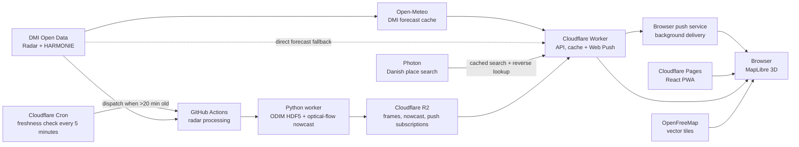

# WetMap

WetMap is a dark-first, accessible 3D weather radar for Denmark. It renders **observed DMI DBZH reflectivity** below OpenStreetMap-derived 3D buildings in MapLibre and keeps the DMI API behind server-side components. It does not claim radar reflectivity is rainfall in mm/h.

Production: **https://wetmap.pages.dev** · API: **https://wetmap-api.wetmap-edge.workers.dev**

On first load, the radar automatically animates recent observations and continues into a separately labelled **radar nowcast** up to +60 minutes. The nowcast estimates motion from the latest two or three measured radar fields with dense optical flow, then advects the newest field. It is a short-term extrapolation—not a future measurement—and its displayed confidence decreases with lead time. A separate “Rain next 60 min” card shows four legible 15-minute HARMONIE estimates. Optional Web Push alerts are sent by the Cloudflare Worker and can arrive while the installed PWA/browser is closed, subject to operating-system and browser delivery policies.

## Run locally

Prerequisite: Docker with Compose v2.

```bash
docker compose up --build
```

Open <http://localhost:8080>. The first start downloads and processes the latest 13 radar composites, so it depends on DMI being available. API health is at <http://localhost:8081/health/ready>. For frontend-only work: `corepack pnpm install && pnpm dev`.

## Architecture



The production path uses a small Cloudflare Worker because static frames, cached point forecasts, and cached Danish location search fit its free tier and avoid a cold-started container. The location search is Denmark-filtered and degrades independently, so a Photon outage does not remove radar, forecasts, map clicks, or saved browser favorites. The .NET 10 modular monolith remains the canonical, portable API and is used in Compose; see [ADR 0002](docs/adr/0002-edge-production-api.md).

## Repository

- `apps/web`: React 19, Vite, MapLibre, TanStack Query, Zustand, Tailwind v4, PWA.
- `apps/api`: .NET 10 Minimal API with Problem Details, rate limiting, caching, health, resilience, and OpenTelemetry.
- `apps/worker`: idempotent Python ODIM HDF5 processor and R2 uploader.
- `packages/shared`: UI-neutral contracts, typed client, color scale, and OKLCH tokens.
- `infra`: Cloudflare edge API, OpenTofu, observability configuration.
- `openapi`: contract-first public API specification.
- `docs`: evidence, ADRs, threat model, SLOs, and runbooks.

## Commands

```bash
corepack pnpm install
pnpm check
python3 -m venv .venv && .venv/bin/pip install -e 'apps/worker[dev]'
.venv/bin/pytest apps/worker/tests
docker build -t wetmap-api apps/api
```

## Deploy

1. Keep the ingestion workflow in a public repository so standard GitHub-hosted Actions do not consume a private-repository minutes allowance. Monitor schedule reliability and acceptable-use limits.
2. Create Cloudflare Pages, R2, and Workers Free resources. R2 activation uses a checkout/subscription flow even within free usage; configure a hard budget alert and lifecycle deletion.
3. Apply `infra/tofu` with an API token scoped to R2 write and account ID in environment secrets.
4. Configure GitHub environments `staging` and `production`. Store credentials such as `CLOUDFLARE_API_TOKEN`, `R2_ACCESS_KEY_ID`, and `R2_SECRET_ACCESS_KEY` as secrets. Keep non-sensitive settings such as `R2_ACCOUNT_ID`, `R2_BUCKET`, `PUBLIC_URL`, and `API_URL` as repository variables. Store a fine-grained, repository-scoped Actions-write token as the Cloudflare Worker secret `GITHUB_DISPATCH_TOKEN`; the Worker's five-minute cron dispatches ingestion only when the newest observation is over 20 minutes old. Generate a VAPID key pair and store `VAPID_PUBLIC_KEY` and `VAPID_PRIVATE_KEY` as Worker secrets; never expose the private key to Pages or GitHub logs.
5. Run `deploy.yml`; production requires an environment approval. Add the Pages domain to the Worker's `ALLOWED_ORIGIN`.

Apply the branch and environment protections in [docs/GITHUB-SETUP.md](docs/GITHUB-SETUP.md). Conventional commits on a protected `main` are released automatically after CI succeeds.

The current GitHub repository and Cloudflare deployment are public and live. Cloudflare provides the primary freshness scheduler, while both the radar and synthetic GitHub schedules remain recovery triggers. Radar ingestion uses an R2 token restricted to object read/write on the `wetmap-radar` bucket. Secrets remain encrypted in their provider secret stores and are not passed to workflows triggered from untrusted forks.

## Free-tier limits & what happens when exceeded

The dated, sourced table is in [docs/FREE-TIER-BUDGET.md](docs/FREE-TIER-BUDGET.md). Key risks are the Workers 100,000 requests/day cap, R2's billing-enabled subscription flow, scheduled-workflow delays, Open-Meteo's free access being non-commercial, and OpenFreeMap having no contractual SLA. The application degrades to last-known-good radar and forecast data when an upstream is unavailable.

## Data and privacy

Browser geolocation is requested only when the user presses the location button. The coordinate is sent to the WetMap Worker for a point forecast and a cached place-name lookup. Searches are proxied through the Worker, while favorites remain in browser storage. If the user explicitly enables background alerts, the browser push endpoint, its public encryption keys, locale, location label, and coordinates rounded to 0.01° are stored in R2. There is no WetMap account or cross-device profile; disabling the alert deletes the subscription, and expired endpoints are removed automatically. DMI data is CC BY 4.0 and every response and visible frame state carries: **“Baseret på data fra DMI og efterfølgende bearbejdet”** plus a fetch timestamp.

## Status

The real 2026-10-10 DMI composite schema was inspected before implementation; see [docs/DMI-DATA-NOTES.md](docs/DMI-DATA-NOTES.md). Current verification evidence, including live Cloudflare checks, is recorded in [docs/TEST-RESULTS.md](docs/TEST-RESULTS.md).
