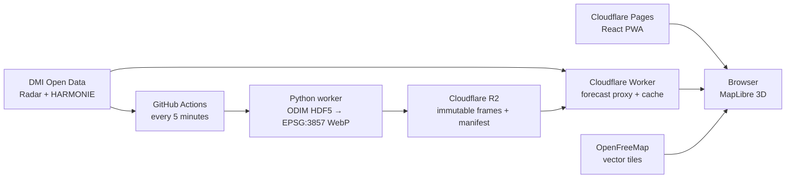

# WetMap

WetMap is a dark-first, accessible 3D weather radar for Denmark. It renders **observed DMI DBZH reflectivity** below OpenStreetMap-derived 3D buildings in MapLibre and keeps the DMI API behind server-side components. It does not claim rainfall in mm/h and does not show predicted radar frames.

Production: **https://wetmap.pages.dev** · API: **https://wetmap-api.wetmap-edge.workers.dev**

The radar timeline opens on the latest published observation and shows the real observation times for the preceding hour. “Now” is the browser clock. DMI's open composite radar feed contains observations, not future radar frames; future hours therefore appear in the HARMONIE point forecast instead of being presented as radar nowcast data.

## Run locally

Prerequisite: Docker with Compose v2.

```bash
docker compose up --build
```

Open <http://localhost:8080>. The first start downloads and processes the latest 13 radar composites, so it depends on DMI being available. API health is at <http://localhost:8081/health/ready>. For frontend-only work: `corepack pnpm install && pnpm dev`.

## Architecture



The production path uses a small Cloudflare Worker because static frames and cached point forecasts fit its free tier and avoid a cold-started container. The .NET 10 modular monolith remains the canonical, portable API and is used in Compose; see [ADR 0002](docs/adr/0002-edge-production-api.md).

## Repository

- `apps/web`: React 19, Vite, MapLibre, TanStack Query, Zustand, Tailwind v4, PWA.
- `apps/api`: .NET 10 Minimal API with Problem Details, rate limiting, caching, health, resilience, and OpenTelemetry.
- `apps/worker`: idempotent Python ODIM HDF5 processor and R2 uploader.
- `packages/shared`: UI-neutral contracts, typed client, color scale, and OKLCH tokens.
- `infra`: Cloudflare edge API, OpenTofu, observability configuration.
- `openapi`: contract-first public API specification.
- `docs`: evidence, ADRs, threat model, SLOs, and runbooks.

## Commands

```bash
corepack pnpm install
pnpm check
python3 -m venv .venv && .venv/bin/pip install -e 'apps/worker[dev]'
.venv/bin/pytest apps/worker/tests
docker build -t wetmap-api apps/api
```

## Deploy

1. Choose the ingestion runner. Public standard GitHub-hosted Actions are free; a private repository has a finite monthly Actions allowance and cannot sustainably run the five-minute schedule without another runner or a separate public ingestion repository.
2. Create Cloudflare Pages, R2, and Workers Free resources. R2 activation uses a checkout/subscription flow even within free usage; configure a hard budget alert and lifecycle deletion.
3. Apply `infra/tofu` with an API token scoped to R2 write and account ID in environment secrets.
4. Configure GitHub environments `staging` and `production`. Store `CLOUDFLARE_API_TOKEN`, `CLOUDFLARE_ACCOUNT_ID`, `R2_*`, and `R2_BUCKET` only as environment secrets.
5. Run `deploy.yml`; production requires an environment approval. Add the Pages domain to the Worker's `ALLOWED_ORIGIN`.

Apply the branch and environment protections in [docs/GITHUB-SETUP.md](docs/GITHUB-SETUP.md). Conventional commits on a protected `main` are released automatically after CI succeeds.

The current GitHub repository is private. Cloudflare deployment is live, while scheduled five-minute radar ingestion remains deliberately gated until its runner/budget choice is made. Manual ingestion can refresh the same R2 manifest without changing the application deployment.

## Free-tier limits & what happens when exceeded

The dated, sourced table is in [docs/FREE-TIER-BUDGET.md](docs/FREE-TIER-BUDGET.md). Key risks are the Workers 100,000 requests/day cap, R2's billing-enabled subscription flow, GitHub Actions being free only for public repositories, and OpenFreeMap having no contractual SLA. The application degrades to the last good radar manifest when DMI is unavailable.

## Data and privacy

Browser geolocation is used only to move the map. The coordinate leaves the device only after the user selects/requests a point forecast; there is no account or database in v1. DMI data is CC BY 4.0 and every response and visible frame state carries: **“Baseret på data fra DMI og efterfølgende bearbejdet”** plus a fetch timestamp.

## Status

The real 2026-10-10 DMI composite schema was inspected before implementation; see [docs/DMI-DATA-NOTES.md](docs/DMI-DATA-NOTES.md). Current verification evidence, including live Cloudflare checks, is recorded in [docs/TEST-RESULTS.md](docs/TEST-RESULTS.md).
