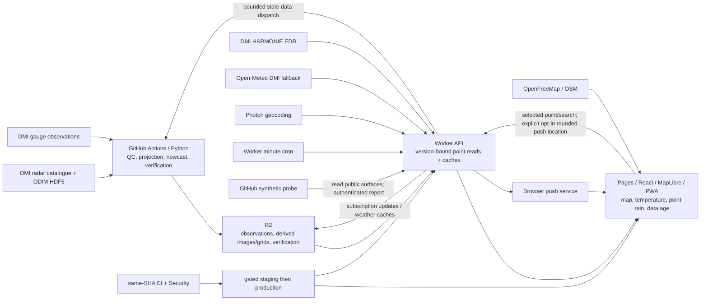

# WetMap baseline checkpoints

## Current master audit — 17 November 2026

Initial source `0b90f43` (16 November PR #38), read-only baseline then targeted
implementation. Owner adopted WETMAP_MASTER_PROMPT.md and requested continuous
work without routine phase pauses; cost/privacy/history/gate safety boundaries
remain. **Partial baseline / incomplete acceptance**, not all Phase 0 targets
measured and not a claim that every phase is complete. October baseline below
is preserved as historical evidence, not current release truth.

### What actually failed since the previous fix

323 workflow runs in the inspected window from 16 November 19:59:40 to
17 November about 21:37 UTC; five failures, not five new code defects:

| UTC time | Copenhagen | Run | Evidence / conclusion |
| --- | --- | --- | --- |
| 16/11 20:20 | 21:20 | Synthetic 43948778540 | Quality child validator failed; captured stderr/rejected report lost. Exact historical invariant unknown. |
| 17/11 07:53 | 08:53 | Radar 44042199730 | Processing completed, zero new frames, source observation 07:25, age 29.2 min. Freshness correctly failed. |
| 17/11 08:00 | 09:00 | Radar 44043106586 | Same source observation, age 36.3 min. |
| 17/11 08:01 | 09:01 | Synthetic 44043246264 | radar:source-delayed and dependent performance:radar-unavailable; other checks passed. |
| 17/11 08:07 | 09:07 | Radar 44044071407 | Same source observation, age 43.5 min. Reason for declined monitoring handoff not retained. |

Radar jobs started roughly five seconds after creation; this was not the old
22/52-minute dependency-cache queue fault. Normal recovery 44045060247 succeeded,
incident resolved 08:17:43 UTC. A bounded current source read around 21:39 UTC
matched WetMap and DMI at observation 21:25 UTC (age 14.2 min). That is not
evidence of historical DMI-wide unavailability or a publish-latency percentile.

### Handover classification

- **Confirmed, historical/currently removed:** dependency cache could exhaust
  radar job deadline; removed by PR #38 before this baseline. Not used to explain
  unrelated subsequent failures.
- **Confirmed, corrected in this implementation:** malformed/empty catalogue
  could replace last-good manifest; diagnostics discarded validator failure;
  active point slot could be overwritten; reader rows not ETag-bound; deploy
  lacked exact-SHA CI/security prerequisite; push input lacked actual byte/type
  validation; repeated push weather decode; missing weather query coordinates.
- **Confirmed limitation:** shared production staging, unequal legacy masks,
  incomplete independent published metric acceptance, CPU/free-tier uncertainty,
  missing protected-main/environment policy and app-log privacy scope.
- **Unknown:** original quality invariant, morning source publication reason and
  historical monitor-handoff denial. No invented provider-outage explanation.
- **Obsolete assumption:** all later GitHub failures are the dependency-cache
  incident. **Unproven claim:** more accumulated data automatically improves the
  active algorithm. Data enables verification; changes still require held-out
  evidence and existing promotion gates.

### Data in / processing / data out



Production is the Worker, not the portable/local .NET API. Browser favourites
remain local; GPS and push require user interaction. Radar is reflectivity aloft,
not literal clouds or guaranteed ground rain. Model/nowcast data are estimates;
valid time, source and observation age must stay visible. API caches: browser →
data-centre Cache API → isolate-local coalescing → R2 last-good → upstream. No
Redis/global lock, no new service. Shared caches/images are not one transaction.

### Independent raw verification checkpoint

Explicitly approved private local snapshot, **22 reads / 10,761,702 bytes**,
stable state, six cubes and thirteen observations. No subscriptions/persondata
and no raw upload. Recompute: **31 published pairs, 43 available pairs, 186 score
comparisons, zero mismatches**, persistence identity 6/6. **BLOCKED:** minimum 50
published pairs unchanged; published-v2/Brier full agreement not independently
accepted. Masks differ in 38 available pairs. Local v2 oracle has no mismatches
but is not a published-ledger acceptance. Safe aggregate: evidence/master-2026-11-17.

The old +15/+30 fail, +45 pass anomaly is not a timestamp-offset explanation in
the checked records. Different lead-window/method cohorts and unequal legacy
masks can affect comparative skill; October baseline below describes that sample.
Do not transplant those historical horizon values to the current report or infer
that one successful quality snapshot validates seasonal/general forecast skill.
V2 stays diagnostic-only; no history, metric definition, algorithm or gate change.

Existing numeric gate contract read from nowcast.py/verification.py: alert CSI
≥0.20, persistence skill ≥0, confidence ≥0.55 and at least 12 version-matched
validation samples. Shadow promotion additionally requires CSI gain ≥0.02 over
the operational incumbent and **false-alarm-ratio increase ≤0.02 (2 percentage
points)**, at least 48 samples / 1,000 event pixels, and applicable probability/recall
requirements. `falseAlarmRate` is the code's field name for FA/(hits+FA), not the
false-positive rate FA/(FA+correct negatives). No threshold or definition changed.

### Measured numbers and biggest remaining problems

- Seven complete UTC days: peak Worker 3,192 requests/day; R2 Class A 7,870/day,
  Class B 15,194/day; storage daily peak 10.443 GB before approved cleanup,
  1.497 GB on 16/11. This is aggregate usage, not an invoice/hard cost cap.
- Daily cron CPU p99 41.854–52.469 ms; fetch p99 20.138–28.023 ms. Actual plan
  API returns 403. Free-tier compliance **UNRESOLVED**; no paid upgrade.
- Local same-workload risk lookup removes 520→13 decodes, p50 38.084→1.034 ms;
  not actual Cloudflare CPU, full push delivery or field p95.
- Six normal Chrome UI states DA/EN, desktop/small screen: no page exceptions
  or horizontal overflow, temperature/map visible. Not actual iPhone/CWV/FPS.
- Ranked open work: independent published metrics/held-out accuracy; measured
  CPU/plan/quota guardrails; isolated test backend; release account protection;
  app-log privacy approval; full cross-browser/device/time/offline acceptance.

Details: FINDINGS.md, RCA.md, TEST_EVIDENCE.md, PERFORMANCE.md, FREE_TIER.md,
RISKS.md and ADRs 0014/0015. A green normal probe isn't full release readiness.

---

## Archived Phase 0 baseline — 22 October 2026

Measured: 2026-10-22 17:23–17:45 UTC

Release: `004e129ed091ebd013defb62e852a7234a39d3fb` (`main`)

Environment: production, read-only checks plus local source/tests

Status: **findings ready for owner review; Phase 1 not started**

## Executive finding

WetMap is operational and the latest public verification data does not show a
forecast/observation timestamp-offset bug. The quality anomaly is mainly real and
explainable: each displayed horizon pools several lead times and several production
methods, while the persistence gate uses an unweighted mean of per-pair CSI
differences. The +45-minute window currently benefits from the adaptive ensemble and
persistence fallback; +15, +30 and +60 contain enough negatively skilled optical-flow
pairs to fail the persistence gate.

There are nevertheless two verification-design risks to resolve before V6 results can
be trusted as release evidence:

1. forecast and persistence categorical scores are calculated with separate valid
   masks rather than one common comparison mask; and
2. the public evidence contract is insufficient to independently reconstruct
   persistence counts, raw-grid MAE and Brier scores.

Performance is the next major product risk after forecast correctness. Five mobile
Lighthouse runs produced a 2.35 s median LCP but a 5.26 s p75 LCP, stable CLS around
0.17 and large run-to-run main-thread variation. The production map route transfers
about 6.78 MB in the median audit run. The point endpoint meets the warm-cache target
in the controlled cold→warm probe (107 ms warm) but missed the 800 ms cold target
(1,057 ms).

## 1. Verification-engine audit

### Independent implementation and evidence

The independent checker is
[`audit_public_quality.py`](../.github/scripts/audit_public_quality.py), with regression
tests in
[`test_audit_public_quality.py`](../.github/scripts/test_audit_public_quality.py).
It does not import WetMap's worker implementation. It parses timestamps and derives
precision, recall, CSI, false-alarm ratio and miss ratio directly from counts.

Command:

```text
cd .github/scripts
python3 -m unittest test_audit_public_quality.py
python3 audit_public_quality.py /tmp/wetmap-quality-latest.json --minimum-pairs 50
```

Result:

- 5/5 audit tests passed;
- 288/288 public pairs included a persistence CSI;
- 0 forecast/observation timestamps were outside the 180-second tolerance;
- 0 declared-lead timestamps disagreed with `basedOnObservedAt + leadMinutes`;
- 0 detailed precision/recall/CSI values differed from independently recomputed values
  beyond the rounding tolerance (0.055 percentage points, stricter than the requested
  0.5 percentage points).

The public detail list is capped at 288 pairs while the aggregate active cohort has
5,200 pairs. Therefore the checker correctly refuses to compare the 288-pair horizon
subtotals with the 5,200-pair observatory totals. The aggregate precision, recall, CSI,
false-alarm ratio and miss ratio are nevertheless arithmetically reproducible from the
published aggregate counts.

### Time alignment

**Finding: pass on code and the 288 public pairs.**

- The archived forecast frame is selected by `predictedAt` against the new
  observation's `observedAt`, not by download/publication time.
- All 288 sampled pairs matched exactly; none merely relied on the ±180-second
  tolerance.
- `basedOnObservedAt + leadMinutes` also matched `predictedAt` for every pair.

### Persistence input

**Finding: code path verified; public reconstruction blocked.**

`generate_nowcast` creates one encoded grid from the newest input observation and
places the same array object at frame zero of the operational verification cube and
each challenger baseline list. `verify_previous_nowcast` uses `cube[..., 0]` as
persistence. Existing worker tests prove that a persistence-selected lead is identical
to cube frame zero and that reflectivity is not confidence-attenuated.

The public report exposes persistence CSI but not persistence hits, misses and false
alarms or a checksum for frame zero. Independent reconstruction from public data is
therefore not possible.

### Coverage and no-echo handling

**Finding: no-echo encoding is correct; common-mask fairness needs work.**

- `0` means outside/no coverage.
- `14` means covered with no echo.
- positive encoded grids are treated as valid coverage, and the 20 dBZ threshold is
  encoded consistently as `20 + 32`.
- Forecast, persistence and observation all pass through the same reflectivity encoder.

However, `_categorical_scores` constructs `valid = predicted > 0 AND actual > 0`
separately for each forecast member. An advected forecast can have a different edge
coverage domain from persistence. Skill should be computed on one common
forecast/persistence/observation mask so both methods see identical pixels. Denmark is
well inside the composite and the effect may be small, but it is a verification risk,
not a proven non-issue.

### MAE and Brier

**Finding: implementation reviewed; independent Phase 0 recomputation blocked.**

- MAE is computed over the union of forecast and observed echo pixels; the +32 encoding
  offset cancels under absolute differences.
- Brier uses the candidate probability grid and observed event indicator on the common
  persistence/observation coverage mask.
- Promotion tests exercise positive and negative Brier skill and prevent promotion
  when Brier skill is negative.

The public endpoint strips per-pair shadow scores and does not publish the raw grids.
An attempted read-only download of `nowcast/verification-history.json` from R2 was
blocked because this session has no non-interactive Cloudflare API token. It would
still provide reported per-pair scores, not 50 retained raw forecast/observation grids.
Consequently MAE/Brier cannot receive an independent PASS yet. Phase 1 must create a
bounded, privacy-safe audit artifact or offline archive that allows this calculation.

## 2. Current forecast-quality baseline

Threshold: 20 dBZ. Quality gate: at least 12 samples, at least 100 event pixels,
pooled CSI ≥ 0.20 and mean per-pair CSI skill over persistence ≥ 0.

| Horizon window | Samples | Rain pixels | Precision | Recall | CSI | Mean pair skill vs persistence | Status |
| --- | ---: | ---: | ---: | ---: | ---: | ---: | --- |
| +15 (10–20) | 1,706 | 525,483 | 61.95% | 58.89% | 43.24% | -0.37 pp | degraded |
| +30 (25–35) | 898 | 309,657 | 48.15% | 45.75% | 30.65% | -0.50 pp | degraded |
| +45 (40–50) | 1,706 | 559,254 | 43.52% | 40.33% | 26.48% | +0.62 pp | verified |
| +60 (55–60) | 868 | 300,251 | 36.80% | 34.27% | 21.57% | -0.54 pp | degraded |

Only one of four horizon windows passes. No V5 horizon was safe to promote at the
measurement time.

### Why the pattern is non-monotonic

The pattern is reproducible without a time-alignment error:

- Radar publication and ingestion usually create many more observations at 10-minute
  lead anchors. The +15 and +45 windows each contain 1,706 samples, while +30 has 898
  and +60 has 868. The horizons are not identically sampled.
- At +20, optical flow has mean skill -4.29 pp across 469 pairs; another 369 pairs use
  persistence at exactly zero skill. This pulls the +15 window below zero even though
  +10 and the sparse +15 anchor are positive.
- At +30, optical flow has mean skill -1.33 pp across 474 pairs and persistence has zero
  skill across 364 pairs. The sparse +25 gain cannot offset it.
- At +40/+50, the regime-adaptive ensemble contributes positive mean skill (+5.25 pp
  and +3.41 pp in its respective cohorts), and persistence limits losses. That method
  mix is sufficient for the +45 window to pass.
- At +60, 360 optical-flow pairs average -4.60 pp, versus 188 adaptive-ensemble pairs
  at +3.19 pp and 261 persistence pairs at zero. The window remains negative.

There is also a presentation/aggregation trap. CSI is pooled from all pixels, but skill
is the simple mean of each forecast pair's `forecast CSI - persistence CSI`. Pooled CSI
therefore cannot be subtracted from the displayed mean persistence CSI to infer the
gate result. This does not prove the gate is wrong, but the weighting difference is
undocumented and makes the observatory misleading. V6 should add paired confidence
intervals and additive event/pixel-weighted skill without changing the existing gate
unless an ADR is explicitly approved.

## 3. End-to-end radar latency

Sample: the 13-frame live manifest, 11 frames that could be correlated to a recent
successful GitHub run, and DMI STAC `properties.created`. R2 visibility is approximated
by the corresponding successful workflow completion time. This is a one-hour sample,
not a rolling SLO.

| Stage | n | p50 | p95 | Interpretation |
| --- | ---: | ---: | ---: | --- |
| measurement → DMI publish | 13 | 7m 33s | 12m 34s | DMI publishes pairs of 5-minute observations roughly every 10 minutes |
| DMI publish → WetMap ingestion start | 13 | 3m 27s | 3m 32s | Scheduler/dispatch latency dominates this controllable gap |
| ingestion start → approximate R2 visible | 11 | 1m 10s | 2m 39s | Includes download, processing, verification, upload and workflow teardown |
| DMI publish → approximate R2 visible | 11 | 4m 34s | 6m 11s | Above the Phase 1 target of ≤3 minutes p95 |
| measurement → approximate R2 visible | 11 | 13m 38s | 17m 36s | Explains the normal 10–20 minute observation age seen by users |

Exact `R2 visible → first client visible` is not instrumented. API metadata is cached
for 60 seconds with stale-while-revalidate, so source inspection provides a bound but
not an observed percentile. Add a publication ID and first-seen synthetic timestamp
before claiming an end-to-end p95.

## 4. API and cache baseline

Ten sequential GETs per endpoint from a Copenhagen Cloudflare edge; values include
client/network time. This is a small diagnostic sample, not a load test.

| Endpoint | p50 | p95 | HTTP result |
| --- | ---: | ---: | --- |
| radar frames | 150 ms | 188 ms | 10/10 200 |
| nowcast manifest | 160 ms | 196 ms | 10/10 200 |
| quality | 154 ms | 227 ms | 10/10 200 |
| observatory | 162 ms | 205 ms | 10/10 200 |
| weather forecast, warm | 105 ms | 156 ms | 10/10 200 |
| precipitation, warm | 92 ms | 212 ms | 10/10 200 |
| location search | 246 ms | 772 ms | 10/10 200 |
| reverse geocode | 75 ms | 293 ms | 10/10 200 |
| push config | 82 ms | 124 ms | 10/10 200 |

The repository's controlled rotating-coordinate probe observed:

```text
MISS@CPH:1057ms, HIT@CPH:107ms
```

The warm result meets the Phase 6 150 ms target; the single cold result misses the
800 ms target. A separate fixed-coordinate sample returned one internal point-cache
MISS followed by nine HITs (90%). All ten outer Cloudflare responses were cache HITs.
Provider-wide cache hit rate is not exported, so 90% must not be presented as the
production rate.

## 5. Web performance and bundle baseline

Lighthouse 12.8.2, mobile simulated throttling, production URL, five runs:

| Metric | Median | p75 (5-run sample) | Target | Result |
| --- | ---: | ---: | ---: | --- |
| Performance score | 83 | 89 | — | highly variable, range 38–90 |
| FCP | 1.87 s | 2.66 s | — | variable |
| LCP | 2.35 s | 5.26 s | ≤2.5 s p75 | fail |
| TBT | 80 ms | 528 ms | proxy only | two severe outliers |
| CLS | 0.170 | 0.170 | ≤0.10 | fail |
| Time to interactive | 4.91 s | 8.74 s | — | slow tail |
| transferred bytes | 6.78 MB | 6.78 MB | — | heavy |

INP needs a scripted interaction or real-user field data and was not produced by the
navigation-only runs.

Production build output:

| Asset | Raw | gzip |
| --- | ---: | ---: |
| `WeatherMap-*.js` | 1,062.6 KB | 286.9 KB |
| MapLibre worker | 508.3 KB | 144.1 KB |
| application entry JS | 312.5 KB | 96.3 KB |
| `WeatherMap-*.css` | 83.0 KB | 10.7 KB |

Vite still emits a chunk-over-500-KB warning. MapLibre is lazy-loaded at the component
boundary, but the large `WeatherMap` chunk and worker mean acceptance criterion A6 is
not met and no CI size budget currently prevents regression.

## 6. Operational and free-tier baseline

Recent radar workflow sample: 100 runs over 16.13 hours.

- 100/100 succeeded.
- 96 were Worker-triggered `workflow_dispatch`; 4 came from GitHub schedule.
- observed rate: 148.8 runs/day;
- duration: 89.5 s median, 407 s p95, 604 s maximum;
- projected runner usage at the observed median: about 6,660 minutes per 30 days.

R2 does not expose operation totals through the repository. Static code-path modelling
for a normal two-new-frame ingestion estimates roughly 25 Class A writes and 12 Class B
reads per run. The minute scheduler with zero subscriptions adds approximately two
Class A and three Class B operations per minute, plus a dispatch-state read/write when
stale. At 149 ingestions/day this is approximately 6.7k Class A and 6.3k Class B
operations/day before browser/API traffic and forecast caches. This is an estimate;
Cloudflare analytics must be captured before any change that increases frequency or
retention.

Alert scan duration is not timed or exported. Subscription count, page count, push
delivery latency and received/displayed/discarded telemetry are also absent. These are
baseline gaps, not zeros.

## 7. UX, language and accessibility inventory

Evidence:

- [desktop, Danish, dark](evidence/phase-0/desktop-da-dark.jpg)
- [desktop, English, dark](evidence/phase-0/desktop-en-dark.jpg)
- [mobile, Danish, dark](evidence/phase-0/mobile-da-dark.jpg)
- [mobile, English, dark](evidence/phase-0/mobile-en-dark.jpg)

Strengths observed:

- map, radar age, source distinction, point forecast and 15-minute rain cells are
  visible without opening a secondary page;
- automatic playback starts, with a visible play/pause control;
- observation and nowcast frames have distinct labels, source time and confidence;
- low-confidence weak radar echo is described honestly rather than as certain rain;
- the timeline can be minimized and offers a direct jump to the latest observation;
- desktop and 360 px layouts remain operable in the audited states;
- visible controls have accessible names in both languages, and a skip link exists.

Gaps observed:

- no light theme exists, so the requested light-mode inventory cannot be performed;
- DMI's legal attribution remains Danish in English mode;
- language returns to Danish after a reload;
- a 22-minute-old observation was labelled “Updated” although the help text says DMI
  normally publishes within 10–20 minutes; the stale threshold is 25 minutes;
- the 360 px layout is dense: the forecast and timeline cover almost the whole map,
  with the rain cells partly obscured when the timeline overlays them;
- MapLibre reports geolocation support unavailable in the audit browser; the disabled
  control is honest, but the product needs its own explanatory path on unsupported
  clients;
- there is no automated axe/Playwright suite despite `docs/TESTING.md` claiming one;
- there is no light/dark preference, text data table for the full map timeline, or
  automated 200% zoom/320 px evidence yet.

## 8. Documentation and observability drift

- `docs/TESTING.md` claims Playwright + axe coverage, but no Playwright/axe dependency,
  configuration or test exists.
- `docs/TEST-RESULTS.md` contains older test counts and quality snapshots and is not a
  current release report.
- `docs/FREE-TIER-BUDGET.md` still estimates 288 radar runs/day and about 21k monthly
  radar/nowcast writes; live behavior is about 149 runs/day, while the minute scan adds
  state/list operations that the old write estimate omits.
- `README.md` describes a five-minute Cloudflare freshness cron, but production
  `wrangler.toml` runs it every minute.
- Exact pipeline-stage, first-client-visible, alert-duration and provider-usage
  dashboards do not exist.

## 9. Ranked problems before V6 implementation

1. **Independent verification evidence is incomplete.** Retain a bounded raw audit set
   or publish non-sensitive sufficient statistics so ≥50 MAE/Brier/persistence checks
   can be independently reproduced.
2. **Use one common validity mask for paired forecast/incumbent/persistence scoring.**
   Add regression tests and quantify whether historical rankings change; do not rewrite
   history or gates without approval.
3. **Define the V6 train/validation/test split and offline archive before tuning.** The
   current 5,200-pair rolling ledger is not a protected test set.
4. **Instrument true end-to-end latency.** DMI publish → R2 is 4m34s p50 / 6m11s p95
   in this sample, above the future 3-minute p95 target.
5. **Build a reproducible backtest harness and event library.** Live waiting and the
   uneven 10-minute anchor distribution make iteration slow and comparisons noisy.
6. **Control web tail performance and layout shift.** LCP p75 and CLS fail; add bundle
   and Lighthouse budgets before UI expansion.
7. **Export operational telemetry.** Cache rate, R2 operations, alert scan duration and
   notification delivery cannot currently be measured as production percentiles.
8. **Fix truthfulness/i18n/a11y drift.** Harmonize the freshness label, persist language,
   localize attribution context, replace the nonexistent test claims with real tests,
   and decide whether light theme is a product requirement.

## 10. Phase 0 acceptance and decision

Phase 0 has produced a useful baseline, but the verification audit is not a complete
PASS because independent MAE/Brier/persistence reconstruction is blocked. No gate,
metric definition, stored history, personal-data policy or production forecast was
changed.

Recommended next step after owner approval:

1. make the verification evidence auditable and fix/test the common-mask comparison;
2. record an ADR only if metric semantics or historical compatibility must change;
3. define the date-based split and build the offline V6 harness;
4. evaluate V6 candidates only in backtest and shadow mode.

The independent release acceptance prompt is intentionally not being executed yet.
It must run after implementation, in a separate no-fix pass, starting on staging.
