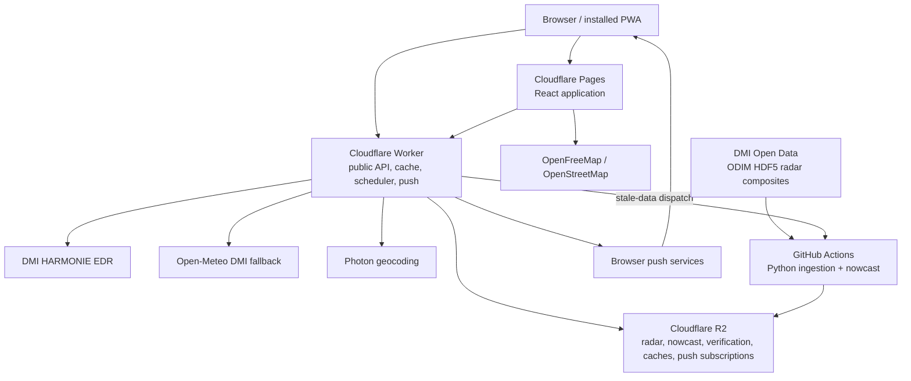

# WetMap system context

Last updated: 2026-10-30

## Purpose

WetMap is a near-real-time 3D precipitation-radar web application for Denmark. It
answers three user questions:

1. Where is precipitation visible on radar now?
2. Where is it expected to move during the next 60 minutes?
3. What does that mean at the selected point?

Production is available at `https://wetmap.pages.dev`. The public edge API is
`https://wetmap-api.wetmap-edge.workers.dev`.

## Production architecture

The Cloudflare Worker cron runs each minute. It checks radar freshness, dispatches
the GitHub radar workflow when required, and scans a bounded page of push
subscriptions. GitHub's own radar schedule is a recovery trigger. The Python worker
is stateless between runs and restores the current manifest, verification ledger and
bounded verification cubes from R2.

The same minute cron now also maintains a separate five-minute monitoring heartbeat
and dispatches an external synthetic check after 15 minutes without a completed
probe. An authenticated report maintains one bounded current incident. Public
`/api/v1/operations/status` remains HTTP 503 while unhealthy, even when a repeated
diagnostic execution succeeds to avoid duplicate mail. See ADR 0009 and
`OPERATIONS_SPRINT.md`; this does not change forecast or push eligibility.

## Repository layout

| Path | Responsibility |
| --- | --- |
| `apps/web` | React 19, TypeScript, Vite, MapLibre, TanStack Query, Zustand and PWA UI |
| `apps/worker` | Python DMI radar ingestion, processing, nowcasting and verification |
| `apps/api` | Portable/local .NET 10 API used by Compose and integration tests |
| `infra/edge` | Production Cloudflare Worker API, caching, scheduler and Web Push |
| `packages/shared` | Shared TypeScript contracts and design tokens |
| `openapi/wetmap-v1.yaml` | Public API contract |
| `infra/tofu` | Cloudflare infrastructure definitions |
| `.github/workflows` | CI, security, deploy, radar, synthetic monitoring and release |
| `docs/adr` | Accepted architecture decisions |

The production API is the edge Worker. The .NET API remains the canonical portable
local implementation; see ADR 0002.

## Radar and nowcast data flow

1. The worker requests the newest DMI composite STAC items.
2. New ODIM HDF5 objects are downloaded and validated.
3. Reflectivity is reprojected to EPSG:3857 and encoded as lossless transparent WebP.
   Coverage, covered/no-echo and detected reflectivity remain distinguishable.
4. The worker builds 5-minute forecast frames through +60 minutes.
5. It emits image manifests, compact point/risk grids, geographic-consistency
   evidence, a compressed verification cube and public/private quality reports.
6. Immutable observed frames are uploaded first. Short-lived derived assets and
   manifests are then published to R2.
7. The edge API serves R2 data with cache metadata. The browser renders the same
   frames and reads point values from the compact grid through the edge API.

Internal times are UTC. The browser formats them in Europe/Copenhagen.

## Current forecast engine

The production algorithm cohort is
`adaptive-optical-flow-persistence-v1`.

- Leads +5 through +35 start with dense Farneback optical flow and can fail closed to
  persistence when the verified optical-flow skill is sufficiently negative.
- Long leads can use separately verified trajectory, speed-corrected and
  regime-adaptive candidates.
- Probability-gated V4 and recall-calibrated V5 remain shadow candidates unless each
  lead independently passes every promotion gate.
- Forecast confidence is metadata; it never attenuates the reflectivity pixels.
- The point forecast and map share the same encoded forecast source. A geographic
  consistency report tests selected Danish locations across all 13 frames.

Current production promotion gates are not to be changed without an approved ADR:

- at least 48 paired shadow samples;
- at least 1,000 event pixels;
- CSI at least 0.20;
- CSI improvement of at least 0.02 over the exact incumbent;
- non-negative skill over persistence;
- false-alarm-rate regression no more than 0.02;
- non-negative Brier skill for probability candidates;
- the additional recall/calibration requirements for V5.

Operational push eligibility has its own fail-closed minimums: 12 validation samples,
CSI at least 0.20, non-negative persistence skill and confidence at least 0.55.

## Verification model

The worker archives a bounded ring of forecast cubes. When a new observation arrives,
every retained forecast whose valid time matches that observation within 180 seconds
is scored. The current public quality endpoint reports the newest 288 detailed pairs
and aggregate statistics for the active algorithm cohort. The private R2 history is
bounded at 5,200 pairs.

Primary verification uses a 20 dBZ significant-echo threshold and also records
5/10/15/20/35 dBZ. Reported metrics include hits, misses, false alarms, precision,
recall, CSI, dBZ MAE and skill against persistence. Probability candidates also record
Brier score and Brier skill. Ground-gauge comparisons are a separate evidence stream;
radar reflectivity aloft is not claimed as ground-truth rainfall.

## Weather and location data

- DMI HARMONIE is the preferred point-forecast source.
- Open-Meteo's DMI distribution is the labelled fallback.
- Near-term precipitation combines the radar point grid/nowcast with model data.
- Photon provides place search and reverse geocoding behind edge caches.
- OpenFreeMap supplies vector map tiles with OpenStreetMap attribution.

## Notifications and privacy

Notifications are explicit opt-in. Subscriptions are stored in R2 with the push
endpoint/keys, locale, display name, rounded latitude/longitude and alert state. There
are no accounts and no general user database. Favourites remain in the browser.
Geolocation is requested only after user interaction.

The alert scanner rejects observations older than 15 minutes, skips forecast times in
the past and adds payload expiry. The service worker drops expired or legacy payloads.
Coordinates must remain rounded to 0.01 degrees unless the privacy design is explicitly
re-approved.

## Delivery and operations

- Pull requests and `main` run TypeScript lint/typecheck/tests/build, Python
  Ruff/pytest/script tests, .NET tests and container builds.
- Security automation covers CodeQL, Gitleaks, Trivy and SBOM generation.
- Deployment proceeds through Cloudflare staging and then production.
- Synthetic monitoring checks Pages, API health, radar freshness, nowcast contracts
  and point-cache behavior.
- The canonical operational limits and procedures are in `SLO.md`,
  `FREE-TIER-BUDGET.md` and `RUNBOOKS.md`.

## Current status and known constraints

The release at the start of the V6 programme is commit `004e129`. Radar ingestion,
map rendering, point forecasts, automatic radar playback, quality observability and
background notification expiry are operational. Forecast quality remains the primary
bottleneck: only the +45-minute observatory window currently passes every gate.

The Phase 0 measurement and ranked findings are in `BASELINE.md`. That document takes
precedence over older point-in-time claims in `TEST-RESULTS.md`.
